# Database reference

The source of truth is [`apps/api/prisma/schema.prisma`](../apps/api/prisma/schema.prisma).
PostgreSQL 16 is the only supported provider. Prisma `Json` fields map to PostgreSQL
`JSONB`; all money fields are `Decimal(12,2)`. IDs are application-generated
`cuid()` strings (the seed uses stable, human-readable ids instead).

## Entity relationship diagram

```mermaid
erDiagram
    User }o--o{ Role : "assigned roles"
    Role }o--o{ Permission : "grants"
    User ||--o{ Session : "refresh sessions"
    User ||--o{ EmailVerificationToken : "verifies"
    User ||--o{ PasswordResetToken : "resets"
    User ||--o{ Address : "saved addresses"
    User ||--o{ Cart : "carts"
    User ||--o{ Order : "places"
    User ||--o{ Review : "writes"
    User ||--o{ CouponUsage : "redeems"
    User ||--o{ UploadedAsset : "uploads"
    User ||--o{ OrderStatusHistory : "changed by"
    User ||--o{ AuditLog : "actor"
    User ||--o{ Notification : "receives"

    Category ||--o{ Category : "parent of"
    Category ||--o{ Product : "contains"
    Category ||--o{ ProductCustomizationSchema : "scopes"
    Category ||--o{ Coupon : "limits"

    Product ||--o{ ProductImage : "gallery"
    Product ||--o{ ProductVariant : "sizes/options"
    Product ||--o{ ProductAttribute : "highlights/tags"
    Product ||--o{ ProductCustomizationSchema : "overrides"
    Product ||--o{ Inventory : "stock key"
    Product ||--o{ CartItem : "in cart"
    Product ||--o{ OrderItem : "ordered"
    Product ||--o{ Review : "reviewed"
    Product ||--o{ Coupon : "limited to"
    Product }o--o{ Product : "related products"

    ProductCustomizationSchema ||--o{ ProductCustomizationField : "defines"

    Cart ||--o{ CartItem : "contains"
    Cart ||--o{ StockReservation : "reserves for"
    CartItem }o--o| ProductVariant : "selected variant"
    CartItem }o--o| Product : "snapshot source"

    Coupon ||--o{ CouponUsage : "redemptions"
    CouponUsage }o--|| Order : "applied to"

    Order ||--o{ OrderItem : "line items"
    Order ||--o{ OrderStatusHistory : "status timeline"
    Order ||--o{ Payment : "payments"
    Order ||--o{ Refund : "refunds"
    Order ||--o{ StockReservation : "reserves"
    Order ||--o{ Review : "purchases"
    Order ||--o{ Notification : "messages"
    Payment ||--o{ Refund : "refunded by"

    Inventory ||--o{ InventoryTransaction : "ledger"
    Inventory ||--o{ StockReservation : "holds"
    StockReservation }o--o| Cart : "cart hold"
    StockReservation }o--o| Order : "order hold"

    Order }o--o| DeliverySlot : "logical ref (id only)"
    Order }o--o| GiftWrap : "logical ref (id only)"

    User {
        String id PK
        String email UK
        String name
        String passwordHash
        DateTime emailVerifiedAt
        Boolean isActive
        DateTime deletedAt
    }
    Role {
        String id PK
        RoleName name UK
        String displayName
    }
    Permission {
        String id PK
        String key UK
    }
    Session {
        String id PK
        String userId FK
        String refreshTokenHash UK
        DateTime expiresAt
        DateTime revokedAt
    }
    Category {
        String id PK
        String slug UK
        String parentId FK
        Int displayOrder
        Boolean isVisible
        DateTime deletedAt
    }
    Product {
        String id PK
        String slug UK
        String sku UK
        String categoryId FK
        Decimal basePrice
        Decimal sellingPrice
        ProductStatus status
        ProductType productType
        Int stockQty
        Decimal ratingAverage
    }
    ProductImage {
        String id PK
        String productId FK
        String url
        Boolean isPrimary
        Int position
    }
    ProductVariant {
        String id PK
        String productId FK
        String sku UK
        Json options
        Decimal price
        Int stockQty
    }
    ProductAttribute {
        String id PK
        String productId FK
        String key
        String value
    }
    ProductCustomizationSchema {
        String id PK
        String productId FK
        String categoryId FK
        String name
    }
    ProductCustomizationField {
        String id PK
        String schemaId FK
        String key
        CustomizationFieldType type
        Json options
        Json validation
        Decimal priceDelta
    }
    Cart {
        String id PK
        String userId FK
        String guestToken UK
        CartStatus status
        String couponCode
    }
    CartItem {
        String id PK
        String cartId FK
        Json productSnapshot
        Int quantity
        Json customizations
        Decimal unitPriceSnapshot
    }
    Coupon {
        String id PK
        String code UK
        CouponType type
        Decimal value
        Decimal minSubtotal
        Boolean firstOrderOnly
        Boolean isActive
    }
    CouponUsage {
        String id PK
        String couponId FK
        String orderId FK
        Decimal discount
    }
    DeliveryZone {
        String id PK
        String name
        String pincodePrefixes
        Decimal deliveryFee
        Decimal freeAbove
    }
    DeliverySlot {
        String id PK
        String code UK
        String windowText
        Decimal fee
    }
    GiftWrap {
        String id PK
        String code UK
        Decimal price
    }
    Order {
        String id PK
        String orderNumber UK
        String userId FK
        OrderStatus status
        Json customerSnapshot
        Json addressSnapshot
        Decimal subtotal
        Decimal discount
        Decimal total
        String idempotencyKey UK
    }
    OrderItem {
        String id PK
        String orderId FK
        String nameSnapshot
        Json variantSnapshot
        Json customizations
        Decimal unitPrice
        Decimal lineTotal
    }
    OrderStatusHistory {
        String id PK
        String orderId FK
        OrderStatus toStatus
    }
    Payment {
        String id PK
        String orderId FK
        PaymentProvider provider
        PaymentStatus status
        Decimal amount
        String idempotencyKey UK
    }
    PaymentWebhookEvent {
        String id PK
        PaymentProvider provider
        String externalId
        String eventType
        Boolean signatureVerified
        DateTime processedAt
    }
    Refund {
        String id PK
        String paymentId FK
        String orderId FK
        Decimal amount
        RefundStatus status
        String idempotencyKey UK
    }
    Inventory {
        String id PK
        String stockKey UK
        String productId FK
        String variantId FK
        Int quantity
        Int reserved
    }
    InventoryTransaction {
        String id PK
        String inventoryId FK
        StockMovement movement
        Int quantity
    }
    StockReservation {
        String id PK
        String inventoryId FK
        String cartId FK
        String orderId FK
        ReservationStatus status
        DateTime expiresAt
    }
    Review {
        String id PK
        String productId FK
        String userId FK
        String orderId FK
        Int rating
        ReviewStatus status
    }
    Notification {
        String id PK
        String userId FK
        String orderId FK
        NotificationChannel channel
        NotificationStatus status
    }
    StoreSetting {
        String id PK
        String key UK
        Json value
    }
    HomepageBanner {
        String id PK
        Boolean isActive
        Int position
    }
    AuditLog {
        String id PK
        String actorId FK
        String action
        String entityType
        Json changes
    }
    IdempotencyRecord {
        String id PK
        String key UK
        String scope
        String fingerprint
        Json result
        DateTime expiresAt
    }
```

`PaymentWebhookEvent` is intentionally standalone: it is deduplicated by the
composite unique key `(provider, externalId)` and is never linked by a foreign
key to a `Payment` so that duplicate/out-of-order callbacks can be stored and
inspected safely.

## Money

- All monetary columns are `Decimal @db.Decimal(12, 2)`: up to 9,999,999,999.99
  INR with exact fixed-point arithmetic. Never use JavaScript floats or SQLite
  for money.
- Convert at the boundary with `Prisma.Decimal` (or the `decimal()`/`add()`/
  `subtract()`/`number()` helpers in `common/utils/money.util.ts`).
- Prices are computed server-side from `Product.sellingPrice`, variant price
  deltas, customization `priceDelta` values, coupon rules and shipping settings.
  Client-supplied prices are rejected.
- Order and cart items store immutable snapshots (`unitPrice`,
  `unitPriceSnapshot`, `nameSnapshot`, `variantSnapshot`, `customerSnapshot`,
  `addressSnapshot`) so catalogue edits never rewrite history.

## JSONB usage

Prisma `Json` columns are PostgreSQL `JSONB`. Current uses:

| Column | Shape |
| --- | --- |
| `Product.dimensions` | `{ lengthCm, widthCm, heightCm }` |
| `ProductVariant.options` | `{ size?: string, color?: string }` |
| `ProductCustomizationField.options` | `[{ value, label, priceDelta?, hex? }]` |
| `ProductCustomizationField.validation` | `{ min?, max?, maxLength?, pattern?, accept?, maxBytes? }` |
| `CartItem.productSnapshot` / `.customizations` | Frozen catalogue item and validated field values |
| `OrderItem.variantSnapshot` / `.customizations` | Checkout-time copies |
| `Order.customerSnapshot` / `.addressSnapshot` | Checkout-time copies |
| `Payment.metadata` / `PaymentWebhookEvent.payload` | Provider payloads (never trusted without signature verification) |
| `StoreSetting.value` | Typed settings object keyed by `StoreSetting.key` |
| `AuditLog.changes` | Before/after diff |
| `IdempotencyRecord.result` | Serialised response replay |

JSONB is good for bounded, schema-driven documents that are read as a whole.
Anything that needs joins, constraints or high-cardinality filtering should stay
in a normal column (e.g. `pincodePrefixes` is a `String[]` so serviceability can
use array containment/indexes).

## Constraints and integrity

- Unique keys enforce business identity: `User.email`, `Role.name`,
  `Permission.key`, `Category.slug`, `Product.slug`/`sku`,
  `ProductVariant.sku`, `Coupon.code`, `DeliverySlot.code`, `GiftWrap.code`,
  `Order.orderNumber`, `Order.idempotencyKey`, `Payment.idempotencyKey`,
  `Refund.idempotencyKey`, `Session.refreshTokenHash`, `Cart.guestToken`,
  `Inventory.stockKey`, `UploadedAsset.objectKey`, `StoreSetting.key`,
  `PaymentWebhookEvent(provider, externalId)`,
  `ProductCustomizationField(schemaId, key)`, `Review(productId, userId)`.
- `Inventory.stockKey` is `p:<productId>` or `v:<variantId>`; exactly one of
  `productId`/`variantId` must be set. Enforce this in the service layer until a
  check constraint is added via migration.
- `Order.deliverySlotId` and `Order.giftWrapId` are plain ids (no Prisma relation
  in the current schema); they are logical references shown as such in the
  diagram. `DeliveryZone` is a lookup used by `checkout/serviceability` and is
  not stored on the order.
- Foreign keys use `Cascade` for owned children (images, variants, cart items,
  order items, sessions, tokens) and `SetNull` where history must survive
  deletions (e.g. `Order.user`, `Review.order`, `CartItem.product`,
  `AuditLog.actor`, `Category.parentId`).
- Soft deletes (`deletedAt`) are used on catalogue rows; always filter
  `deletedAt: null` in public queries. Do not soft-delete orders or payments.
- `Order.idempotencyKey` and `Payment.idempotencyKey` are additional
  database-level guards on top of `IdempotencyRecord` claims.

## Transactions

Wrap any write that touches money, stock or multiple aggregates in
`prisma.$transaction`. In particular:

1. **Checkout / place order** — re-read and validate the cart, run
   `CustomizationService.validateAndPrice`, recalculate totals, claim the
   idempotency key, create `Order` + `OrderItem` + `CouponUsage` +
   `StockReservation`, mark the cart `CONVERTED`, and write the first
   `OrderStatusHistory`. All or nothing.
2. **Stock reservation** — increment `Inventory.reserved` and insert a
   `StockReservation` with an `expiresAt` in the same transaction. The
   scheduler expires stale rows and releases the matching `reserved` count.
3. **Payment confirmation** — only a verified provider callback or server-side
   verification may move `Payment.status` to `PAID`; insert the
   `PaymentWebhookEvent` row (unique on provider + external id) first, then
   update the payment and order status.
4. **Refunds** — create `Refund` with its unique `idempotencyKey`, call the
   provider, then record the provider refund id and status transition.
5. **Idempotency** — `IdempotencyService.claim()` inserts a scoped record; the
   same key with a different payload fingerprint yields HTTP 409. Call
   `complete()` inside the same transaction as the business write, and
   `release()` on failure so a client can retry.

Avoid long-running network calls inside a transaction. Verify signatures and
prepare payloads first; keep the transaction short.

## Indexing and query patterns

Existing indexes target the actual access paths:

- Catalogue: `(categoryId, status)`, `(status, isFeatured)`, `sellingPrice`,
  `name`, `(productId, position)` for images, `(schemaId, position)` for fields.
- Orders: `(userId, createdAt)`, `(status, createdAt)`, `createdAt`,
  `(orderId, createdAt)` for status history.
- Inventory: `stockKey` (unique), `(productId)`, `(variantId)`,
  `(status, expiresAt)` for the expiry worker.
- Notifications/notifications queue: `(status, scheduledAt)`, `(orderId)`.
- Audit/idempotency: `(actorId, createdAt)`, `(entityType, entityId)`,
  `(expiresAt)`.

Guidelines:

- Always include a tenant/owner predicate that matches a leading index column
  (`userId`, `productId`, `orderId`) before sorting or filtering.
- Use cursor/keyset pagination on `(createdAt, id)` for very large admin lists;
  the public API currently uses page/limit with `skipTake()`.
- Prefix search for SKUs, slugs and pincodes can later use `pg_trgm` or a
  `text_pattern_ops` index; do not wrap indexed columns in functions in WHERE.
- Keep `EXPLAIN (ANALYZE, BUFFERS)` in the review checklist for any new admin
  report query. Avoid `SELECT *` on wide tables with JSONB columns.
- `ANALYZE` runs automatically; after bulk seed/imports run `VACUUM (ANALYZE)`
  during a maintenance window.
